<picture><source media="(prefers-color-scheme: dark)" srcset="assets/hero-dark.svg"></picture>

<picture><source media="(prefers-color-scheme: dark)" srcset="assets/about-dark.svg"></picture>

<picture><source media="(prefers-color-scheme: dark)" srcset="assets/stack-dark.svg"></picture>

<picture><source media="(prefers-color-scheme: dark)" srcset="assets/stats-dark.svg"></picture>

<picture><source media="(prefers-color-scheme: dark)" srcset="assets/wave-dark.svg"></picture>

<a href="https://afh21-21.github.io"><picture><source media="(prefers-color-scheme: dark)" srcset="assets/button-site-dark.svg"></picture></a>  <a href="https://github.com/afh21-21?tab=repositories"><picture><source media="(prefers-color-scheme: dark)" srcset="assets/button-repos-dark.svg"></picture></a>

<a href="https://t.me/LeonardoFlynn"><picture><source media="(prefers-color-scheme: dark)" srcset="assets/social-telegram-dark.svg"></picture></a>  <a href="https://discord.com/users/1352214863895728128"><picture><source media="(prefers-color-scheme: dark)" srcset="assets/social-discord-dark.svg"></picture></a>  <a href="https://github.com/afh21-21"><picture><source media="(prefers-color-scheme: dark)" srcset="assets/social-github-dark.svg"></picture></a>

